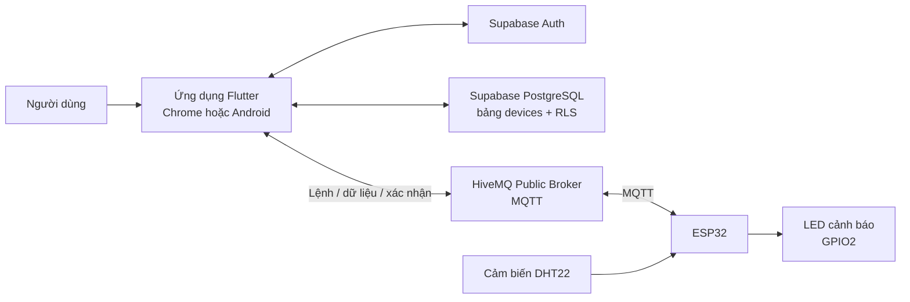

# BÁO CÁO TỔNG HỢP DỰ ÁN SMART HOME IoT

> **Tên đề tài:** Xây dựng mô hình Smart Home theo dõi nhiệt độ, độ ẩm và điều khiển qua ứng dụng<br>
> **Thành viên:** [Bổ sung họ tên các thành viên]<br>
> **Lớp:** [Bổ sung lớp]<br>
> **Giảng viên hướng dẫn:** [Bổ sung họ tên giảng viên]<br>
> **Ngày hoàn thiện báo cáo:** 13/11/2026

> **[CHÈN ẢNH BÌA: ảnh tổng quan mô hình hoặc ảnh giao diện ứng dụng]**
> *Gợi ý: dùng ảnh tự chụp mô hình ESP32 và màn hình ứng dụng; không để lộ mật khẩu, khóa bí mật hoặc thông tin tài khoản.*

## Mục lục

1. [Tóm tắt dự án](#1-tóm-tắt-dự-án)
2. [Bối cảnh và mục tiêu](#2-bối-cảnh-và-mục-tiêu)
3. [Phạm vi chức năng](#3-phạm-vi-chức-năng)
4. [Kiến trúc hệ thống](#4-kiến-trúc-hệ-thống)
5. [Công nghệ sử dụng](#5-công-nghệ-sử-dụng)
6. [Thiết bị và sơ đồ kết nối](#6-thiết-bị-và-sơ-đồ-kết-nối)
7. [Cơ sở dữ liệu và bảo mật](#7-cơ-sở-dữ-liệu-và-bảo-mật)
8. [Luồng hoạt động](#8-luồng-hoạt-động)
9. [Cài đặt và chạy dự án](#9-cài-đặt-và-chạy-dự-án)
10. [Kiểm thử và kết quả](#10-kiểm-thử-và-kết-quả)
11. [Giới hạn hiện tại và hướng phát triển](#11-giới-hạn-hiện-tại-và-hướng-phát-triển)
12. [Kết luận](#12-kết-luận)
13. [Liên kết tham khảo](#13-liên-kết-tham-khảo)

## 1. Tóm tắt dự án

Smart Home IoT là mô hình thực hành kết hợp ứng dụng Flutter, bo mạch ESP32, cảm biến DHT22, giao thức MQTT và dịch vụ Supabase. Người dùng đăng ký hoặc đăng nhập vào ứng dụng, quản lý danh sách thiết bị của tài khoản, bật/tắt mô hình Smart AC và theo dõi nhiệt độ, độ ẩm do ESP32 gửi về.

Ứng dụng và ESP32 trao đổi dữ liệu qua broker MQTT HiveMQ công cộng. Supabase đảm nhiệm xác thực người dùng và lưu danh sách thiết bị. Dữ liệu cảm biến hiện được truyền trực tiếp qua MQTT, chưa lưu thành lịch sử trong cơ sở dữ liệu.

**Lưu ý về phạm vi:** “Smart AC” trong dự án là công tắc điều khiển mô hình và luồng cảm biến, không điều khiển máy lạnh thật. Các thiết bị minh họa khác trên giao diện chưa được nối với phần cứng trong phiên bản này.

## 2. Bối cảnh và mục tiêu

Trong hệ thống nhà thông minh, thiết bị cần có khả năng nhận dữ liệu từ môi trường, truyền dữ liệu đến giao diện giám sát và phản hồi lệnh điều khiển. Dự án xây dựng một phiên bản nhỏ để minh họa các thành phần đó với linh kiện phổ biến và nền tảng đám mây.

Các mục tiêu chính:

- Đọc nhiệt độ và độ ẩm trong môi trường bằng DHT22.
- Dùng ESP32 kết nối Wi-Fi và truyền dữ liệu qua MQTT.
- Xây dựng ứng dụng Flutter có thể chạy trên trình duyệt hoặc thiết bị Android.
- Xác thực người dùng và quản lý danh sách thiết bị bằng Supabase.
- Gửi lệnh bật/tắt từ ứng dụng tới ESP32 và chờ xác nhận lệnh.
- Bật đèn cảnh báo khi nhiệt độ vượt ngưỡng đã đặt trong firmware.
- Cung cấp mô phỏng Wokwi để quan sát và trình bày mô hình.

## 3. Phạm vi chức năng

| Hạng mục | Trạng thái trong phiên bản hiện tại |
|---|---|
| Đăng ký và đăng nhập | Dùng Supabase Auth |
| Danh sách thiết bị | Thêm, xem, sửa và xóa thiết bị của người dùng trong Supabase |
| Cập nhật danh sách | Dùng Realtime của Supabase |
| Điều khiển Smart AC | Gửi lệnh MQTT tới thiết bị ESP32 có ID `esp32-dht22-01` và xử lý xác nhận |
| Theo dõi cảm biến | Hiển thị nhiệt độ và độ ẩm nhận qua MQTT |
| Đèn cảnh báo | Firmware bật/tắt LED theo ngưỡng nhiệt độ |
| Các công tắc thiết bị minh họa khác | Chưa nối với phần cứng hoặc luồng MQTT trong phiên bản này |
| Lịch sử cảm biến trong cơ sở dữ liệu | Chưa triển khai |
| Gửi thông báo email | Chưa triển khai |
| Điều khiển máy lạnh thật | Không thuộc phạm vi mô hình hiện tại |

> **[CHÈN ẢNH 1: màn hình đăng nhập/đăng ký của ứng dụng]**
> *Gợi ý chú thích: “Hình 1. Màn hình xác thực người dùng”.*

> **[CHÈN ẢNH 2: trang chủ sau khi đăng nhập]**
> *Gợi ý chú thích: “Hình 2. Trang chủ và danh sách thiết bị minh họa”.*

> **[CHÈN ẢNH 3: màn hình quản lý thiết bị]**
> *Gợi ý chú thích: “Hình 3. Thêm, cập nhật hoặc xóa thiết bị trong danh sách”.*

## 4. Kiến trúc hệ thống



### Vai trò của từng thành phần

- **Ứng dụng Flutter:** cung cấp giao diện đăng nhập, quản lý thiết bị, gửi lệnh và hiển thị dữ liệu cảm biến.
- **Supabase:** xác thực tài khoản; lưu danh sách thiết bị trong PostgreSQL; giới hạn quyền đọc/ghi bằng RLS; phát cập nhật Realtime.
- **HiveMQ:** broker trung gian chuyển tiếp bản tin giữa ứng dụng và ESP32.
- **ESP32:** nhận lệnh MQTT, đọc DHT22, gửi dữ liệu cảm biến và điều khiển LED.
- **DHT22:** đo nhiệt độ và độ ẩm.
- **LED:** minh họa trạng thái cảnh báo theo ngưỡng nhiệt độ.

### Các MQTT topic chính

| Topic | Mục đích |
|---|---|
| `smarthome/esp32-dht22-01/control` | Ứng dụng gửi lệnh điều khiển |
| `smarthome/esp32-dht22-01/ack` | ESP32 gửi xác nhận đã xử lý lệnh |
| `smarthome/esp32-dht22-01/temperature` | ESP32 gửi dữ liệu nhiệt độ và độ ẩm |

Ứng dụng native kết nối HiveMQ qua MQTT TCP cổng `1883`; phiên bản web dùng WebSocket bảo mật tại `wss://broker.hivemq.com/mqtt:8884`.

> **[CHÈN ẢNH 4: sơ đồ kiến trúc do nhóm vẽ hoặc ảnh sơ đồ Mermaid]**
> *Có thể giữ sơ đồ Mermaid ở trên thay cho ảnh, hoặc chèn sơ đồ tự thiết kế để báo cáo dễ trình bày hơn.*

## 5. Công nghệ sử dụng

| Công nghệ | Công dụng |
|---|---|
| Flutter và Dart | Xây dựng ứng dụng giao diện đa nền tảng |
| Supabase Auth | Đăng ký, đăng nhập và quản lý phiên người dùng |
| PostgreSQL trên Supabase | Lưu danh sách thiết bị |
| Row Level Security (RLS) | Hạn chế mỗi người dùng chỉ truy cập dữ liệu thuộc tài khoản của mình |
| Supabase Realtime | Cập nhật danh sách thiết bị khi dữ liệu thay đổi |
| MQTT | Trao đổi lệnh và dữ liệu giữa ứng dụng với ESP32 |
| HiveMQ Public Broker | Môi giới MQTT phục vụ mô phỏng và trình diễn |
| ESP32 / Arduino | Kết nối Wi-Fi, đọc cảm biến và điều khiển LED |
| DHT22 | Đo nhiệt độ và độ ẩm |
| Wokwi | Mô phỏng phần cứng ESP32 trực tuyến |

## 6. Thiết bị và sơ đồ kết nối

### Linh kiện chính

- Bo mạch ESP32.
- Cảm biến DHT22.
- LED cảnh báo; nếu dùng LED rời cần có điện trở hạn dòng.
- Dây nối và cáp USB cấp nguồn/nạp chương trình.
- Mạng Wi-Fi 2.4 GHz có kết nối Internet.

### Kết nối chân

| Linh kiện | Chân ESP32 |
|---|---|
| DHT22 VCC | 3.3V |
| DHT22 GND | GND |
| DHT22 DATA | GPIO15 |
| LED cảnh báo | GPIO2, qua điện trở 220–330Ω nếu dùng LED rời |

Với DHT22 rời chưa có mạch module, cần điện trở kéo lên khoảng 4.7–10kΩ giữa DATA và 3.3V. Một số module DHT22 đã tích hợp điện trở này.

Firmware bật LED khi mô hình đang hoạt động và nhiệt độ đạt **35°C**; LED tắt khi nhiệt độ giảm còn **33°C hoặc thấp hơn**. Khoảng chênh này giúp tránh trạng thái bật/tắt liên tục khi nhiệt độ dao động sát ngưỡng.

> **[CHÈN ẢNH 5: sơ đồ đấu dây hoặc ảnh chụp phần cứng thật]**
> *Gợi ý: ghi chú rõ GPIO15, GPIO2, 3.3V và GND trên ảnh.*

> **[CHÈN ẢNH 6: mô hình ESP32/DHT22 trên Wokwi]**
> *Gợi ý: chụp toàn bộ sơ đồ và mở Serial Monitor nếu muốn minh họa dữ liệu đang chạy.*

## 7. Cơ sở dữ liệu và bảo mật

Dự án dùng Supabase project hiện có. Bảng `public.devices` lưu danh sách thiết bị với các trường chính:

| Trường | Ý nghĩa |
|---|---|
| `id` | Mã định danh bản ghi |
| `user_id` | Tài khoản sở hữu bản ghi |
| `content` | Nội dung/tên thiết bị |
| `created_at` | Thời điểm tạo |

Row Level Security được bật để giới hạn dữ liệu theo tài khoản đã đăng nhập. Ứng dụng dùng publishable/anon key ở phía client; quyền truy cập dữ liệu phải được kiểm soát bằng policy RLS, không dựa vào việc giấu public key. **Không đưa `service_role`/secret key, mật khẩu Wi-Fi hoặc mật khẩu tài khoản vào ứng dụng, báo cáo hay GitHub.**

Dữ liệu cảm biến không được lưu vào bảng `devices`; bảng này chỉ phục vụ danh sách thiết bị. Nhiệt độ và độ ẩm hiện được truyền trực tiếp qua MQTT, vì vậy ứng dụng chưa có biểu đồ hoặc truy vấn lịch sử đo.

> **[CHÈN ẢNH 7: bảng `public.devices` và phần RLS policies trong Supabase]**
> *Trước khi chụp, che hoặc loại bỏ email, dữ liệu cá nhân và mọi thông tin khóa/secret.*

## 8. Luồng hoạt động

### 8.1. Đăng nhập và tải danh sách thiết bị

1. Người dùng đăng ký hoặc đăng nhập trong ứng dụng.
2. Flutter gửi thông tin xác thực đến Supabase Auth.
3. Sau khi xác thực, ứng dụng truy vấn danh sách thiết bị.
4. PostgreSQL áp dụng policy RLS để chỉ trả về dữ liệu được phép của người dùng đó.
5. Supabase Realtime giúp giao diện nhận cập nhật khi danh sách thay đổi.

### 8.2. Bật mô hình và nhận dữ liệu

1. Người dùng bật Smart AC trên giao diện.
2. Ứng dụng tạo lệnh có `deviceId`, `commandId`, `type: "power"` và trạng thái `"on"`, rồi gửi lên topic `/control`.
3. ESP32 nhận lệnh và gửi xác nhận trên topic `/ack`.
4. Khi lệnh được xác nhận, giao diện cập nhật trạng thái mô hình.
5. ESP32 đọc DHT22 và gửi dữ liệu lên topic `/temperature` theo chu kỳ khoảng 5 giây khi mô hình đang bật.
6. Ứng dụng nhận bản tin MQTT và hiển thị nhiệt độ, độ ẩm.
7. Firmware điều khiển LED cảnh báo theo ngưỡng nhiệt độ.

Ví dụ cấu trúc lệnh (mã lệnh thực tế được tạo riêng cho mỗi lần gửi):

```json
{
  "deviceId": "esp32-dht22-01",
  "commandId": "<mã-lệnh>",
  "type": "power",
  "state": "on"
}
```

### 8.3. Tắt mô hình

Khi người dùng tắt Smart AC, ứng dụng gửi lệnh `"off"` qua cùng topic điều khiển và chờ ESP32 xác nhận. Màn hình ngừng hiển thị dữ liệu cảm biến như trạng thái đang bật. Việc bật/tắt ở đây chỉ quản lý mô hình IoT và không đóng/ngắt máy lạnh thật.

> **[CHÈN ẢNH 8: Smart AC ở trạng thái tắt]**

> **[CHÈN ẢNH 9: Smart AC đang bật, có nhiệt độ và độ ẩm]**
> *Nếu có ảnh LED sáng khi đạt ngưỡng cảnh báo, có thể chèn thêm tại đây.*

## 9. Cài đặt và chạy dự án

Hướng dẫn cài Flutter, chạy trên Chrome/Android, cấu hình Supabase và nạp firmware ESP32 được viết chi tiết tại [README hướng dẫn cài đặt](README.md).

Lệnh chạy mẫu trên Chrome:

```powershell
flutter pub get
flutter run -d chrome --dart-define="SUPABASE_URL=https://nxecjrkjmtsguoftmgaq.supabase.co" --dart-define="SUPABASE_ANON_KEY=DAN_PUBLISHABLE_KEY_VAO_DAY"
```

Thay `DAN_PUBLISHABLE_KEY_VAO_DAY` bằng publishable/anon key lấy từ Supabase Dashboard trên máy chạy ứng dụng. Không ghi key thật vào báo cáo hoặc commit lên GitHub. Firmware cũng cần được cấu hình Wi-Fi cục bộ trước khi nạp; không chia sẻ mật khẩu Wi-Fi.

## 10. Kiểm thử và kết quả

Theo lần kiểm thử gần nhất trong quá trình hoàn thiện dự án:

- `flutter test`: **7/7 bài kiểm thử thành công**.
- `flutter analyze --no-fatal-infos`: hoàn tất không có lỗi mức fatal; có một số thông báo `info` liên quan đến API Flutter đã deprecated trong SDK mới.
- Ứng dụng web đã mở được trang đăng nhập; endpoint kiểm tra sức khỏe Supabase Auth phản hồi HTTP 200.
- Đã xác nhận cấu hình bảng `public.devices`, RLS và Realtime trên Supabase.

Các kết quả trên xác nhận kiểm thử tự động và khả năng khởi chạy giao diện. Chưa có bằng chứng trong báo cáo này rằng toàn bộ thao tác đăng nhập, CRUD và kết nối cảm biến đã được kiểm thử trên tài khoản/phần cứng thật ở mọi môi trường; kết quả thực tế còn phụ thuộc cấu hình Supabase, Wi-Fi, broker và thiết bị.

> **[CHÈN ẢNH 10: kết quả chạy `flutter test`]**

> **[CHÈN ẢNH 11: Serial Monitor hoặc màn hình ứng dụng nhận dữ liệu từ ESP32 thật]**
> *Nếu chỉ kiểm thử trên Wokwi, ghi chú rõ ảnh là mô phỏng, không phải phần cứng thật.*

## 11. Giới hạn hiện tại và hướng phát triển

### Giới hạn

1. **Broker MQTT công cộng:** HiveMQ public không yêu cầu xác thực trong cấu hình hiện tại; topic demo có thể được người khác nhìn thấy hoặc sử dụng. Không dùng cấu hình này cho hệ thống thực tế.
2. **Chưa có lưu lịch sử cảm biến:** dữ liệu nhiệt độ/độ ẩm chỉ đi qua MQTT, chưa được ghi vào bảng riêng trong Supabase.
3. **Không điều khiển máy lạnh thật:** Smart AC là trạng thái của mô hình; chưa có relay/IR hoặc thiết bị điều khiển máy lạnh.
4. **Thiết bị giao diện chưa đồng nhất với phần cứng:** các công tắc minh họa khác chưa kết nối ESP32.
5. **Chưa có thông báo email:** phiên bản hiện tại chưa triển khai gửi email khi vượt ngưỡng.
6. **Ngưỡng cảnh báo cố định:** 35°C bật và 33°C tắt đang được quy định trong firmware, chưa cấu hình từ ứng dụng.
7. **Phụ thuộc kết nối Internet:** ứng dụng, Supabase, broker và ESP32 cần mạng hoạt động để trao đổi dữ liệu.

### Hướng phát triển

- Chuyển sang MQTT broker riêng có xác thực, TLS và phân quyền topic.
- Tách cấu hình theo môi trường, quản lý thông tin nhạy cảm an toàn.
- Tạo bảng lịch sử cảm biến và biểu đồ theo thời gian.
- Cho phép người dùng cấu hình ngưỡng cảnh báo; bổ sung thông báo trong ứng dụng/email nếu có yêu cầu.
- Kết nối thiết bị thật an toàn, có kiểm tra trạng thái và xử lý mất kết nối.
- Bổ sung kiểm thử tích hợp cho đăng nhập, CRUD, MQTT và thiết bị.

## 12. Kết luận

Dự án đã ghép nối được các thành phần cơ bản của một mô hình Smart Home IoT: ứng dụng Flutter, xác thực và lưu danh sách thiết bị trên Supabase, truyền lệnh/dữ liệu qua MQTT, và ESP32 đọc cảm biến DHT22 để gửi nhiệt độ/độ ẩm, điều khiển LED cảnh báo. Wokwi cung cấp phương án minh họa khi chưa có phần cứng thật.

Phiên bản hiện tại phù hợp cho học tập và trình diễn nguyên lý kết nối IoT. Trước khi sử dụng ngoài môi trường thực tế, cần thay broker công cộng bằng dịch vụ có bảo mật, bổ sung giám sát kết nối và kiểm thử phần cứng. Báo cáo cũng nêu rõ các chức năng chưa triển khai để phân biệt phần mô phỏng với chức năng đã hoàn thiện.

## 13. Liên kết tham khảo

- [Mã nguồn GitHub](https://github.com/tuan102136/ckthay_y)
- [Mô phỏng ESP32 trên Wokwi](https://wokwi.com/projects/480414337988797441)
- [Supabase Dashboard](https://supabase.com/dashboard/project/nxecjrkjmtsguoftmgaq)
- Supabase API URL: `https://nxecjrkjmtsguoftmgaq.supabase.co`
- [Hướng dẫn cài đặt và chạy dự án](README.md)

> Supabase API URL là địa chỉ dịch vụ, không phải trang giao diện để mở trực tiếp. Khi mở URL gốc trên trình duyệt có thể thấy `requested path is invalid`; hãy dùng URL này trong cấu hình chạy ứng dụng.
